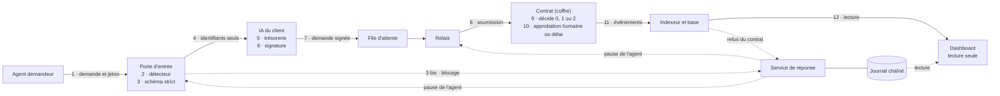

# Argent Intelligent

Passerelle de confiance entre des agents IA et la trésorerie d'une entreprise.
Projet du hackathon Secure Horizons, track 1 « Fintech Security ».

Ce README dit ce qui tourne aujourd'hui. Ce qui est conçu mais pas écrit est
marqué comme tel : voir [État des composants](#état-des-composants).

## Problème

Un agent IA peu privilégié, nourri d'un document piégé, peut ordonner un
paiement à un agent financier. Sans contrôle de la chaîne d'autorité, le
paiement part.

## Solution

- Chaque demande est testée à l'entrée et reçoit un score et des codes raison.
- Un contrat décide sur son propre état : refusé, validation humaine, accepté.
  L'agent ne fournit que des identifiants ; le montant et le bénéficiaire sont
  ceux inscrits au contrat.
- Une attaque détectée déclenche quarantaine, pause de l'agent, alerte et
  rapport d'incident. Aucune action automatique ne déplace de fonds.
- Chaque étape est journalisée dans un journal chaîné, vérifiable par un script.

Le contrat est aujourd'hui une interface gelée, sans implémentation. Le reste
du flux tourne contre un faux coffre.

## Architecture

Dix composants, douze étapes. Conception : [specs/](specs/README.md).



| # | Étape | Composant | Dossier |
|---|---|---|---|
| 1 | Un agent s'authentifie avec un jeton court et envoie une demande | Porte d'entrée | `gateway/` |
| 2 | Tests de sécurité : score et codes raison | Porte d'entrée | `gateway/` |
| 3 | Validation contre un schéma strict | Porte d'entrée | `gateway/` |
| 3 bis | Échec en 2 ou 3 : quarantaine, pause de l'agent, alerte, rapport | Service de réponse | `response/` |
| 4 | Transmission des identifiants à l'IA du client, jamais du document | Porte d'entrée | `gateway/` |
| 5 | L'IA du client fait sa gestion de trésorerie | IA du client | bouchon, `relay/` |
| 6 | Elle émet une demande signée par la clé du client | IA du client | `relay/` |
| 7 | La demande entre dans la file | File | `relay/` |
| 8 | Le relais soumet la demande signée | Relais | `relay/` |
| 9 | Le contrat vérifie la signature, décide 0, 1 ou 2 et agit | Contrat | absent |
| 10 | Cas 1 : un humain approuve, ou le délai expire et la demande est refusée | Contrat | absent |
| 11 | Un indexeur lit les événements et alimente la base | Indexeur | `relay/` |
| 12 | Le dashboard affiche décisions, plaçable, délais et rapports | Dashboard | `dashboard/` |

Les étapes 1 à 4 et 6 à 8 écrivent une entrée dans le journal, tenu par
`response/`. Les décisions du contrat (9 et 10) y sont recopiées par le service
de réponse, qui les lit dans l'indexeur. Les étapes 5, 11 et 12 n'écrivent rien.

## Installation

Prérequis : Node 22, npm, make, curl et jq. Foundry (forge, anvil) est
facultatif : il sert aux contrats de `src/` et au test du relais sur chaîne
locale.

```bash
cp .env.example .env
```

Remplir `.env` avec des clés de **test uniquement**. Ne jamais commiter ce
fichier. Aucun service ne lit `.env` de lui-même : il se charge dans le shell.

```bash
set -a; . ./.env; set +a
```

Tout ce qui suit tourne avec les valeurs par défaut, sans aucune clé.

Chaque dossier applicatif est un paquet Node autonome :

```bash
(cd gateway && npm ci --ignore-scripts)
```

```bash
(cd response && npm ci --ignore-scripts)
```

```bash
(cd relay && npm ci --ignore-scripts)
```

```bash
(cd dashboard && npm ci --ignore-scripts)
```

## Lancer

Chaque service écoute sur `127.0.0.1` seulement. Un terminal par service.

| Service | Commande | Port |
|---|---|---|
| Journal et réponse | `cd response && npm start` | 8790 |
| Porte d'entrée | `cd gateway && npm start` | 8780 |
| Relais, indexeur, API en lecture | `cd relay && npm start` | 8787 |
| Dashboard simulé | `cd dashboard && npm run dev:fixtures`, puis `npm run dev:sim` | 5173 |

Le journal se lance en premier : sans lui, la porte refuse tout. Sans contrat
configuré, le relais démarre « coffre fermé » et ne soumet rien. Détail des
variables : `gateway/README.md`, `response/README.md`, `relay/README.md`,
`dashboard/README.md`.

## Lancer la démo

**État réel : il n'y a pas encore de commande unique, ni de `make demo`.** Ce
bloc sera mis à jour quand elle existera. Trois choses se jouent aujourd'hui.

**1. La scène sur le dashboard, simulée.** Scénarios 3, 4 puis 1, servis par des
fixtures : rien ne vient d'un vrai service.

```bash
cd dashboard && npm run dev:fixtures
```

```bash
cd dashboard && npm run dev:sim
```

**2. Le scénario 3 en vrai, de la porte d'entrée au rapport d'incident.** Avec
`response/` et `gateway/` lancés, depuis la racine : un agent envoie le document
piégé des exemples.

```bash
curl -s -X POST http://127.0.0.1:8780/requests \
  -H "Authorization: Bearer $(jq -r '.agents["A-DEM-2"].token' gateway/var/agent-tokens.json)" \
  -H 'content-type: application/json' \
  --data @specs/examples/inbound/valid/03-document-piege.json
```

La demande est rejetée. L'agent est en pause et un rapport existe :

```bash
curl -s http://127.0.0.1:8790/agents/paused
```

```bash
curl -s http://127.0.0.1:8790/incidents
```

Le journal se vérifie, depuis `response/` :

```bash
npm run verify-journal -- var/journal.jsonl
```

La pause ne se lève que par la commande humaine du [playbook](docs/playbook.md).

**3. Les scénarios contre le faux coffre, en test.**

```bash
cd relay && npm test
```

Ce qui ne se joue pas aujourd'hui : un paiement réel, le refus d'une attaque
par un contrat sur une chaîne, la pause d'un agent sur la chaîne, la scène
complète enchaînée de l'agent au dashboard.

## Vérifier

```bash
make check
```

Rejoue la CI en local : secrets, contrats, dépendances, specs, tests de chaque
dossier, livrables.
Deux étapes informatives, `offchain` et `semgrep`, échouent aujourd'hui
sans arrêter la commande : le `Makefile` dit pourquoi pour la première.

```bash
make docs
```

Contrôle les livrables : formules interdites, liens, chemins cités, secrets,
et qu'aucun chiffre de la fiche ne vient d'ailleurs que d'un fichier de mesure.

## Résultats

Aucune mesure finale n'est enregistrée. Le tableau vit dans la
[fiche de défense](docs/fiche-defense.md), rempli par un script depuis
[docs/mesures/](docs/mesures/README.md). Les seuls chiffres existants viennent
d'un jeu provisoire écrit par l'auteur des règles : ils ne sont pas repris ici.

## État des composants

**Fait** : le code et ses tests sont dans le dépôt. **Branché** : relié à ses
voisins réels, pas à un bouchon. **Absent** : n'existe pas.

| Composant | Où | Fait | Branché | À savoir |
|---|---|---|---|---|
| Agents scriptés | `relay/src/agents.ts` | oui | non | Ils passent par un bouchon de porte (`relay/src/gateway-stub.ts`), pas par `gateway/` |
| Porte d'entrée | `gateway/` | oui | oui, au journal | Transmission à l'IA du client prévue par `CLIENT_AI_URL` ; l'enchaînement n'a pas été rejoué pour ce README |
| Détecteur | `gateway/src/detector.ts` | oui | oui | Règles déterministes, sans modèle. Mesure finale absente |
| Journal chaîné | `response/src/journal.ts` | oui | oui | Écrivain unique. « Au moins une fois » : une entrée peut apparaître deux fois, jamais zéro |
| Service de réponse | `response/src/engine.ts` | oui | oui, à la porte et à l'API du relais | L'alerte est affichée et journalisée, envoyée à personne. Aucune pause sur la chaîne |
| IA du client | `relay/src/client-ia.ts` | bouchon | oui, à la file | Signe tout ce qui passe le schéma. Aucun modèle |
| File d'attente | `relay/src/queue.ts` | oui | oui | SQLite, idempotente |
| Relais | `relay/src/relay.ts` | oui | au journal et aux pauses, par configuration | Soumet à un faux coffre en test. Écarte un agent en pause en lisant le service de réponse |
| Contrat (coffre) | `specs/contract/IArgentVault.sol` | **absent** | non | Interface gelée, aucune implémentation. `relay/src/fake-vault.ts` rejoue ses règles en mémoire, sans fonds |
| Indexeur et API | `relay/src/indexer.ts`, `relay/src/api.ts` | oui | non | Rien à indexer sans contrat déployé |
| Dashboard | `dashboard/` | oui | simulé par défaut | Lecture seule. Lit `relay/` et `response/` sur demande (`dashboard/README.md`) ; le coffre est simulé tant qu'aucun contrat n'est déployé |
| Commande de démo | | **absent** | | Pas de `make demo` |
| Mesure du détecteur | `docs/mesures/` | **absent** | | Jeu prêt dans `data/jeu-factures/`, non lancé |

`src/`, `test/`, `script/` et `offchain/` contiennent d'autres contrats et leurs
services (un marché de vérification, `src/VerificationMarket.sol`). Ce n'est pas
le coffre de [specs/02-contrat.md](specs/02-contrat.md), et ils ne sont pas dans
le flux décrit ici.

## Limites connues

Du kit :

- L'injection de prompt n'est pas empêchée, ses conséquences sont bornées.
- Le contrat ne vérifie pas la vérité d'une facture.
- Un propriétaire compromis sort du modèle.
- Seuls les fonds détenus par le contrat sont protégés.
- Données synthétiques, réseau de test, aucun audit indépendant.

Du dépôt :

- Pas de contrat : aucune règle de paiement n'est prouvée sur une chaîne.
- La pause d'un agent est appliquée par la porte d'entrée et par le relais,
  pas par un contrat.
- Aucune authentification entre services : ils n'écoutent que sur la machine
  locale, et quiconque y accède peut écrire au journal ou consigner une
  décision humaine.
- Sans empreinte de tête gardée ailleurs, une troncature en fin de journal
  passe inaperçue.
- Le jeu de mesure est synthétique, écrit par un modèle, à 1 attaque pour 1
  légitime : ses taux ne valent pas pour le monde réel.

Détail : [fiche de défense](docs/fiche-defense.md), « Limites ».

## Livrables

| Document | Contenu |
|---|---|
| [docs/fiche-defense.md](docs/fiche-defense.md) | Fiche de défense d'une page, métriques |
| [docs/playbook.md](docs/playbook.md) | Playbook de réponse, état de chaque étape |
| [docs/conformite.md](docs/conformite.md) | Contenu de la slide conformité |
| [docs/pitch/questions-reponses.md](docs/pitch/questions-reponses.md) | Réponses aux questions du jury, et ce que nous ne disons pas |
| [docs/demo/script-video.md](docs/demo/script-video.md) | Script de la vidéo de démo |
| [docs/deck/plan.md](docs/deck/plan.md) | Plan du deck en huit slides |
| [docs/mesures/](docs/mesures/README.md) | Fichiers de mesure et leur format |

## Équipe

| Nom | Rôle |
|---|---|
| Wladimir | Contrat |
| Loris | Porte d'entrée et réponse |
| Joseph | Relais, dashboard, CI, livrables |
| Nicolas | Pitch et relecture |
