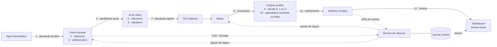

# Argent Intelligent

Passerelle de confiance entre des agents IA et la trésorerie d'une entreprise.
Projet du hackathon Secure Horizons, track 1 « Fintech Security ».

Ce README dit ce qui tourne aujourd'hui. Ce qui est conçu mais pas écrit est
marqué comme tel : voir [État des composants](#état-des-composants).

## Problème

Un agent IA peu privilégié, nourri d'un document piégé, peut ordonner un
paiement à un agent financier. Sans contrôle de la chaîne d'autorité, le
paiement part.

## Solution

- Chaque demande est testée à l'entrée et reçoit un score et des codes raison.
- Un contrat décide sur son propre état : refusé, validation humaine, accepté.
  L'agent ne fournit que des identifiants ; le montant et le bénéficiaire sont
  ceux inscrits au contrat.
- Une attaque détectée déclenche quarantaine, pause de l'agent, alerte et
  rapport d'incident. Aucune action automatique ne déplace de fonds.
- Chaque étape est journalisée dans un journal chaîné, vérifiable par un script.

Le contrat existe : `src/ArgentVault.sol`. Il décide et paie sur un réseau de
test local seulement (anvil, chaîne 31337), avec `VAULT_MODE=chain`. Par défaut,
`VAULT_MODE=fake` : le flux tourne contre un faux coffre, sans fonds ni chaîne.

## Cadrage du paiement

**Démontré, sur réseau de test.** Le coffre détient des fonds de test et paie
dans la transaction de décision : événement `Paid`, suivi d'un transfert natif.

**Envisagé, non construit.** En production, `Paid` serait l'autorisation qu'un
connecteur bancaire consomme. Dans ce mode, le contrat ne détient plus les
fonds : la garantie « seuls les fonds détenus par le contrat sont protégés » ne
s'applique plus, et le connecteur devient un composant de confiance à concevoir
(finalité, rejeu, montant et bénéficiaire lus dans l'événement). Ce connecteur
n'existe pas : ni code, ni spec.

**État du dépôt.** Le premier mode est celui de la spec ([02-contrat.md](specs/02-contrat.md) § 1
et § 8) et de l'interface gelée. Le contrat est écrit (`src/ArgentVault.sol`) et
`VAULT_MODE=chain make demo` le déploie sur un réseau de test local (anvil,
chaîne 31337) : « démontré » vaut pour ce réseau local et pour lui seul. Aucun
réseau de test public n'est testé. En mode fake, le mode par défaut, rien n'est
payé : un faux coffre rejoue les règles, sans fonds.

## Architecture

Dix composants, douze étapes. Conception : [specs/](specs/README.md).



| # | Étape | Composant | Dossier |
|---|---|---|---|
| 1 | Un agent s'authentifie avec un jeton court et envoie une demande | Porte d'entrée | `gateway/` |
| 2 | Tests de sécurité : score et codes raison | Porte d'entrée | `gateway/` |
| 3 | Validation contre un schéma strict | Porte d'entrée | `gateway/` |
| 3 bis | Échec en 2 ou 3 : quarantaine, pause de l'agent, alerte, rapport | Service de réponse | `response/` |
| 4 | Transmission des identifiants à l'IA du client, jamais du document | Porte d'entrée | `gateway/` |
| 5 | L'IA du client fait sa gestion de trésorerie | IA du client | bouchon, `relay/` |
| 6 | Elle émet une demande signée par la clé du client | IA du client | `relay/` |
| 7 | La demande entre dans la file | File | `relay/` |
| 8 | Le relais soumet la demande signée | Relais | `relay/` |
| 9 | Le contrat vérifie la signature, décide 0, 1 ou 2 et agit | Contrat | `src/` |
| 10 | Cas 1 : un humain approuve, ou le délai expire et la demande est refusée | Contrat | `src/` |
| 11 | Un indexeur lit les événements et alimente la base | Indexeur | `relay/` |
| 12 | Le dashboard affiche décisions, plaçable, délais et rapports | Dashboard | `dashboard/` |

Les étapes 1 à 4 et 6 à 8 écrivent une entrée dans le journal, tenu par
`response/`. Les décisions du contrat (9 et 10) y sont recopiées par le service
de réponse, qui les lit dans l'indexeur. Les étapes 5, 11 et 12 n'écrivent rien.

## Installation

Prérequis : Node 22, npm, make, curl et jq. Foundry (forge, anvil) est
facultatif en mode fake ; il est requis pour les contrats de `src/`, pour le
test du relais sur chaîne locale et pour `VAULT_MODE=chain`.

```bash
cp .env.example .env
```

Remplir `.env` avec des clés de **test uniquement**. Ne jamais commiter ce
fichier. Aucun service ne lit `.env` de lui-même : il se charge dans le shell.

```bash
set -a; . ./.env; set +a
```

Tout ce qui suit tourne avec les valeurs par défaut, sans aucune clé.

Chaque dossier applicatif est un paquet Node autonome :

```bash
(cd gateway && npm ci --ignore-scripts)
```

```bash
(cd response && npm ci --ignore-scripts)
```

```bash
(cd relay && npm ci --ignore-scripts)
```

```bash
(cd dashboard && npm ci --ignore-scripts)
```

## Lancer

Chaque service écoute sur `127.0.0.1` seulement. Un terminal par service.

| Service | Commande | Port |
|---|---|---|
| Journal et réponse | `cd response && npm start` | 8790 |
| Porte d'entrée | `cd gateway && npm start` | 8780 |
| Relais, indexeur, API en lecture | `cd relay && npm start` | 8787 |
| Dashboard simulé | `cd dashboard && npm run dev:fixtures`, puis `npm run dev:sim` | 5173 |

Le journal se lance en premier : sans lui, la porte refuse tout. Sans contrat
configuré, le relais démarre « coffre fermé » et ne soumet rien. Détail des
variables : `gateway/README.md`, `response/README.md`, `relay/README.md`,
`dashboard/README.md`.

## Lancer la démo

Une commande lance toute la chaîne sur `127.0.0.1` : service de réponse (8790),
porte d'entrée (8780), IA du client (8770), relais et API (8787), dashboard
(5173). Il faut Node 22.18 ou plus récent et les dépendances de `response/`,
`gateway/`, `relay/` et `dashboard/` (`npm ci --ignore-scripts` dans chacun).

```bash
make demo
```

```bash
make scenes
```

```bash
make demo-stop
```

`make scenes` joue les scénarios de
[specs/acceptance/scenarios.md](specs/acceptance/scenarios.md) par la vraie porte
d'entrée, en HTTP, avec le jeton de chaque agent, puis compare ce que les
services ont fait à ce que la spec attend. En mode fake, toute décision, tout
montant et tout « payé » que les scènes lisent vient d'un **coffre simulé** :
aucun fonds, aucune chaîne. Une ligne par scène : « OK », « ÉCART CONNU (identifiant) »
ou « ÉCART ». Les écarts connus sont listés dans
[demo/ecarts-connus.json](demo/ecarts-connus.json), avec leur responsable ; la
commande les réaffiche à chaque passage. Elle sort en échec pour un écart qui
n'est pas dans la liste, et aussi pour un écart de la liste qui ne se produit
plus, pour que la liste reste vraie. Chaque scène repart d'un état neuf, donc
d'un coffre simulé neuf. Une seule scène : `make scene S=4`. Les scènes 5 et 6b
attendent pour de bon : 30 secondes chacune.

| Commande | Effet |
|---|---|
| `make demo-status` | Service, port, état |
| `make demo-reset` | Archive le journal, les rapports et les bases du relais, réémet les jetons, relance les services. Rien n'est effacé |
| `make demo-smoke` | Lance, joue les scènes 1, 2, 3, 4 et 8 deux fois sur le coffre simulé avec une remise à zéro entre les deux, vérifie le journal, cherche jeton, clé ou signature complète dans les logs, contrôle les droits de `var/demo/`, arrête tout |
| `make demo-test` | Tests de `demo/` sans aucun service : écarts connus, ports, recherche de secrets |
| `make demo-chain-check` | Mode chain sur anvil avec une doublure de contrat : la chaîne de services, sans aucune règle de paiement |

Les pid, un log par service et les bases du relais sont sous `var/demo/`, jamais
versionné. `make demo-stop` n'arrête que ce que `make demo` a lancé. Les ports
sont fixes : ni un `.env` ni l'environnement ne les déplacent, parce que
`GATEWAY_PORT` sert aussi à `offchain/`.

### Ce qui est réel, ce qui est simulé

Par défaut, `VAULT_MODE=fake` : **le coffre est simulé**. Aucun fonds, aucune
chaîne.

| Élément | En mode fake |
|---|---|
| Porte d'entrée, jetons, détecteur `regles-0.3`, schéma | Réel : `gateway/`, en HTTP |
| Journal chaîné, réactions, pauses hors chaîne, rapports d'incident | Réel : `response/` |
| File, relais, indexeur, API en lecture | Réel : `relay/` |
| IA du client | Bouchon : signe tout ce qui passe le schéma, sans modèle |
| Coffre et ses décisions | **Simulé** : `relay/src/fake-vault.ts` rejoue les règles de la spec en mémoire, dans le processus du relais. « Payé » y est un nombre qui baisse |
| Clé du client | Tirée à chaque `make demo`, gardée sous `var/demo/`, lisible par son seul propriétaire |
| Approbateur (scènes 6a et 6b) | Simulé : un port de contrôle de démo (8788) appelle `approve`, `refuse`, `expire` du faux coffre |
| Pause d'un agent sur la chaîne | Absente : aucun composant ne la pose |
| Dashboard | Lancé en mode réel, branché sur le relais et le service de réponse. Bandeau permanent « COFFRE SIMULÉ : aucun fonds, aucune chaîne » ; étiquette « simulation » sur le plaçable, les décisions, les cas en attente et les pauses sur la chaîne. Écrans regardés après les scènes 3, 4, 6a et 1 ; pas pendant la scène 5 |

Ce que `make scenes` a montré le jour de cette rédaction, en mode fake, donc
sur le coffre simulé : les décisions, les motifs, les montants et les réactions
attendus par la spec sont observés dans les dix scènes. Aucun écart connu ne
reste : la liste est vide.

Scène 5, relais arrêté : l'alerte de disponibilité part après 15 s en file, le
service de réponse la lisant dans le journal ; puis `QUEUE_EXPIRED` s'écrit à
l'échéance, l'IA du client balayant aussi la file. Rien n'est soumis ni payé.

Hors liste, signalé en note par les scènes 3 et 4 : `AGENT_PAUSED (ONCHAIN)`,
annoncé « plus tard » par la spec, n'est jamais écrit. Aucun composant ne pose
de pause sur la chaîne ; la pause observée est hors chaîne.

`VAULT_MODE=chain make demo` vise un vrai contrat sur un réseau de test local
(anvil) : la commande lance anvil, déploie `src/ArgentVault.sol` et inscrit le
monde de test, sans jamais se replier sur le faux coffre. Elle lit six clés de
rôle dans l'environnement (`OWNER_PRIVATE_KEY`, `ADMISSION_PRIVATE_KEY`,
`RELAYER`, `APPROVER_PRIVATE_KEY`, `GUARDIAN_PRIVATE_KEY`, `CLIENT_SIGNER`) et
s'arrête si l'une manque. **En mode chain, la démo utilise les clés de
développement publiques d'anvil**, celles qu'anvil affiche à son lancement et
qu'il approvisionne : en local uniquement, jamais sur un réseau partagé, où
n'importe qui peut signer avec elles. Elles se passent par l'environnement du
shell et ne s'écrivent pas dans le dépôt. `make scenes` se lance avec le même
`VAULT_MODE=chain` et les mêmes clés ; la mesure qui en sort est dans
[docs/mesures/demo.json](docs/mesures/demo.json). Fuji n'est pas testé. Ce qui
ne se joue toujours pas : la pause d'un agent sur la chaîne.

Le journal se vérifie, depuis `response/` :

```bash
npm run verify-journal -- var/journal.jsonl
```

Une pause ne se lève que par la commande humaine du [playbook](docs/playbook.md).

## Vérifier

```bash
make check
```

Rejoue la CI en local : secrets, contrats, dépendances, specs, tests de chaque
dossier, livrables.
Deux étapes informatives, `offchain` et `semgrep`, échouent aujourd'hui
sans arrêter la commande : le `Makefile` dit pourquoi pour la première.

```bash
make docs
```

Contrôle les livrables : formules interdites, liens, chemins cités, secrets,
et qu'aucun chiffre de la fiche ne vient d'ailleurs que d'un fichier de mesure.

## Résultats

La mesure du détecteur est enregistrée. Sur un jeu de test synthétique, une
attaque pour une légitime, il détecte 50 attaques sur 100 et bloque à tort 4
demandes légitimes sur 100. Ces chiffres valent pour ce jeu, pas pour le monde
réel : en production les attaques sont rares, et la part des blocages à tort
serait bien plus forte.

Le tableau complet, les cas manqués et les lignes encore « à mesurer » vivent
dans la [fiche de défense](docs/fiche-defense.md), remplie par un script depuis
[docs/mesures/](docs/mesures/README.md). Les chiffres du jeu provisoire écrit
par l'auteur des règles ne sont pas repris ici.

## État des composants

**Fait** : le code et ses tests sont dans le dépôt. **Branché** : relié à ses
voisins réels, pas à un bouchon. **Absent** : n'existe pas.

| Composant | Où | Fait | Branché | À savoir |
|---|---|---|---|---|
| Agents scriptés | `relay/src/agents.ts` | oui | non | Ceux des tests passent par un bouchon de porte (`relay/src/gateway-stub.ts`). Les scènes de `make scenes` passent par `gateway/` |
| Porte d'entrée | `gateway/` | oui | oui, au journal | Transmet à l'IA du client par `CLIENT_AI_URL` : enchaînement joué par `make scenes` |
| Détecteur | `gateway/src/detector.ts` | oui | oui | Règles déterministes, sans modèle. Mesuré sur un jeu synthétique, une attaque pour une légitime : 50 attaques détectées sur 100, 4 demandes légitimes bloquées sur 100 ([fiche de défense](docs/fiche-defense.md)) |
| Journal chaîné | `response/src/journal.ts` | oui | oui | Écrivain unique. « Au moins une fois » : une entrée peut apparaître deux fois, jamais zéro |
| Service de réponse | `response/src/engine.ts` | oui | oui, à la porte et à l'API du relais | L'alerte est affichée et journalisée, envoyée à personne. Aucune pause sur la chaîne |
| IA du client | `relay/src/client-ia.ts` | bouchon | oui, à la file | Signe tout ce qui passe le schéma. Aucun modèle. Balaie aussi la file pour expirer une demande, relais arrêté ou non |
| File d'attente | `relay/src/queue.ts` | oui | oui | SQLite, idempotente |
| Relais | `relay/src/relay.ts` | oui | au journal et aux pauses | Soumet au contrat sur anvil en `VAULT_MODE=chain`, à un faux coffre par défaut et dans ses tests. Écarte un agent en pause en lisant le service de réponse |
| Contrat (coffre) | `src/ArgentVault.sol` | oui | en `VAULT_MODE=chain` | Implémente l'interface gelée `specs/contract/IArgentVault.sol`, tests dans `test/ArgentVault.t.sol`. Déployé par `make demo` sur un réseau de test local (anvil, 31337), nulle part ailleurs. En mode fake, `relay/src/fake-vault.ts` rejoue ses règles en mémoire, sans fonds |
| Indexeur et API | `relay/src/indexer.ts`, `relay/src/api.ts` | oui | oui | Dans `make demo`, indexe les événements du contrat sur anvil en `VAULT_MODE=chain`, ceux du faux coffre par défaut |
| Dashboard | `dashboard/` | oui | simulé par défaut | Lecture seule. Lit `relay/` et `response/` sur demande (`dashboard/README.md`) ; en mode fake le coffre est simulé, et la page l'affiche : bandeau « COFFRE SIMULÉ » dans `make demo`. En mode chain, le bandeau ne s'affiche pas |
| Commande de démo | `Makefile` | oui | oui | `make demo`, `make scenes`. Coffre simulé par défaut ; `VAULT_MODE=chain` déploie le contrat sur anvil. Aucun écart connu avec la spec : `demo/ecarts-connus.json` est vide |
| Mesure du détecteur | `docs/mesures/` | oui | | Jeu de test de `data/jeu-factures/` lancé, résultat dans `docs/mesures/bench-test.json`, repris par la [fiche de défense](docs/fiche-defense.md). Règles fixes de référence et délais : encore « à mesurer ». Les lignes du contrat se lisent dans la fiche, avec leur réserve |
| Marché de vérification | `src/` | oui | oui, sur le L1 AWS | Prouvé sur le L1 de démo (`docs-jury/preuves/`) ; son verdict n'entre pas encore dans la décision du coffre |
| L1 VETO | `infra/l1/` | oui | oui | L1 privé Avalanche, chainId 191919, VETO natif, TxAllowList et Native Minter |
| Passerelle, cache et vérificateurs | `offchain/` | oui | oui, au marché | Services de vérification ; l'évaluateur est factice, le vérificateur LLM est en construction |

`src/`, `test/`, `script/` et `offchain/` contiennent aussi un marché de
vérification, prouvé de bout en bout sur le L1 de démo
([docs-jury/](docs-jury/README.md)). Au temps 1, son verdict n'entre pas dans
la décision du coffre ; leur jonction est conçue, non construite. Les specs
donnent Fuji (chainId 43113), tandis que la chaîne utilisée est le L1 AWS
(chainId 191919).

## Limites connues

Du kit :

- L'injection de prompt n'est pas empêchée, ses conséquences sont bornées.
- Le contrat ne vérifie pas la vérité d'une facture.
- Un propriétaire compromis sort du modèle.
- Seuls les fonds détenus par le contrat sont protégés. Dans le mode envisagé
  avec un connecteur bancaire, cette garantie ne s'applique plus : voir
  [Cadrage du paiement](#cadrage-du-paiement).
- Données synthétiques, réseau de test, aucun audit indépendant.

Du dépôt :

- Le contrat n'a tourné que sur un réseau de test local (anvil) : aucune règle
  de paiement n'est prouvée sur un réseau public, de test ou non.
- La pause d'un agent est appliquée par la porte d'entrée et par le relais. Le
  contrat sait mettre un agent en pause, mais aucun composant ne la pose sur
  la chaîne.
- Aucune authentification entre services : ils n'écoutent que sur la machine
  locale, et quiconque y accède peut écrire au journal ou consigner une
  décision humaine.
- Sans empreinte de tête gardée ailleurs, une troncature en fin de journal
  passe inaperçue.
- Le jeu de mesure est synthétique, écrit par un modèle, à 1 attaque pour 1
  légitime : ses taux ne valent pas pour le monde réel.

Détail : [fiche de défense](docs/fiche-defense.md), « Limites ».

## Livrables

| Document | Contenu |
|---|---|
| [docs/fiche-defense.md](docs/fiche-defense.md) | Fiche de défense d'une page, métriques |
| [docs/playbook.md](docs/playbook.md) | Playbook de réponse, état de chaque étape |
| [docs/conformite.md](docs/conformite.md) | Contenu de la slide conformité |
| [docs/pitch/questions-reponses.md](docs/pitch/questions-reponses.md) | Réponses aux questions du jury, et ce que nous ne disons pas |
| [docs/demo/script-video.md](docs/demo/script-video.md) | Script de la vidéo de démo |
| [docs/deck/plan.md](docs/deck/plan.md) | Plan du deck en huit slides |
| [docs/mesures/](docs/mesures/README.md) | Fichiers de mesure et leur format |
| [docs-jury/README.md](docs-jury/README.md) | Partie blockchain : sommaire, état du marché et du coffre, décomptes de tests mesurés |
| [docs-jury/architecture.md](docs-jury/architecture.md) | L1 privé VETO (chainId 191919, TxAllowList, Native Minter), contrats par phase, ArgentVault, part hors chaîne |
| [docs-jury/flux-demande.md](docs-jury/flux-demande.md) | Parcours d'une demande dans le marché : commit, reveal, code 0/1/2, contestation |
| [docs-jury/fautes.md](docs-jury/fautes.md) | Les trois fautes des vérificateurs, leurs sanctions, nos limites |
| [docs-jury/rapport-securite.md](docs-jury/rapport-securite.md) | Revue de sécurité interne du marché, du coffre et du L1 ; pas un audit indépendant |
| [docs-jury/tests.md](docs-jury/tests.md) | Suites Foundry et hors chaîne, familles de tests, commandes |
| [docs-jury/mesures-gaz.md](docs-jury/mesures-gaz.md) | Tailles des contrats et coûts en gaz mesurés |
| [docs-jury/rejouer-la-demo.md](docs-jury/rejouer-la-demo.md) | Redéployer la pile et rejouer la scène d'attaque sur le L1 |
| [docs-jury/preuves/](docs-jury/preuves/README.md) | Extraits nettoyés des runs : scène d'attaque et bout en bout sur le L1, coffre, Slither, gaz |

## Équipe

| Nom | Rôle |
|---|---|
| Wladimir | Contrats (coffre ArgentVault, marché de vérification), L1 Avalanche VETO, services de vérification hors chaîne |
| Loris | Porte d'entrée et réponse |
| Joseph | Relais, dashboard, CI, livrables |
| Nicolas | Pitch et relecture |
